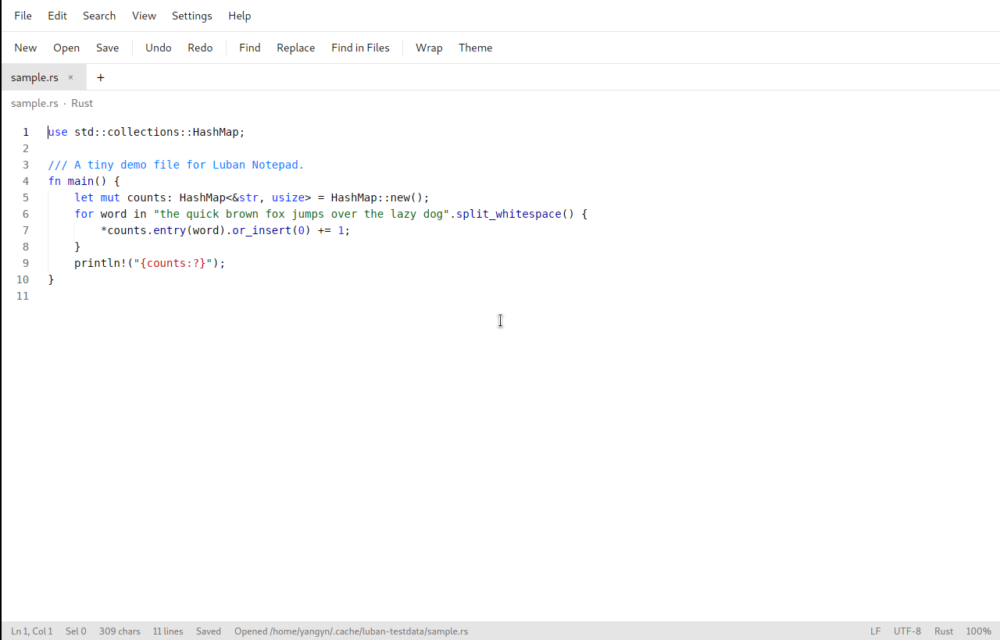
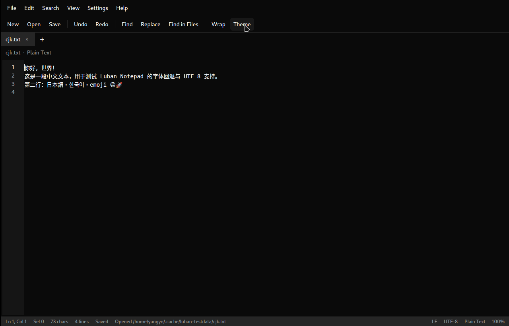
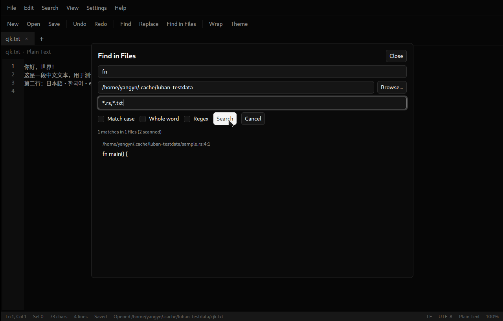
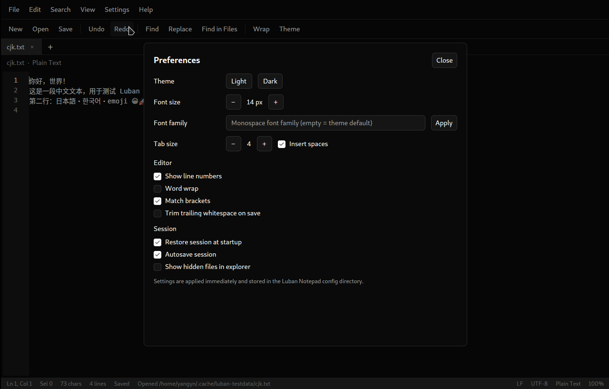
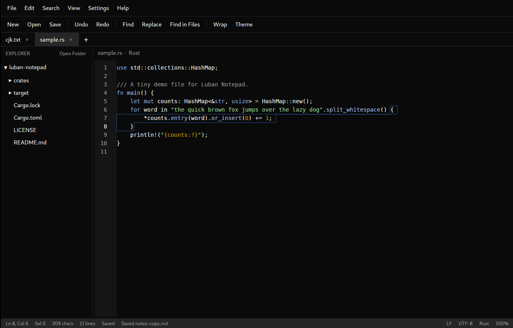
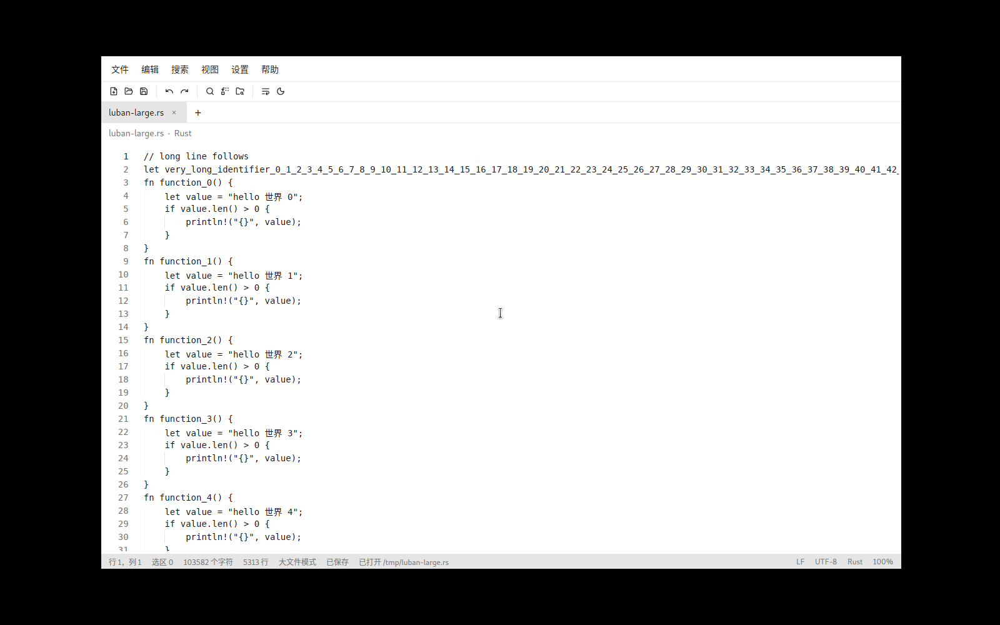
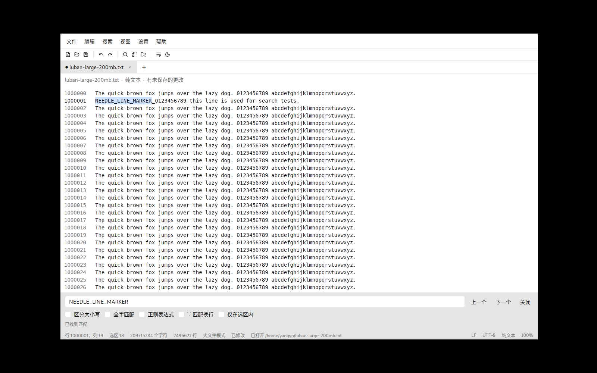

# Luban Notepad（鲁班编辑器）

> 一个使用 Rust 重新实现、跨平台的 Notepad++ 编辑体验，
> 基于 [GPUI Kit](https://gpui-kit.com) 构建。



Luban Notepad 是一个完全使用 Rust 编写的原生桌面文本与源代码编辑器。它保留了
Notepad++ 中人们日常最常用的部分——快速的标签页编辑、语法高亮、跨文件查找/替换、
编码与换行符控制、会话恢复——并在现代、跨平台的基础上重新实现。

它用同一套代码运行在 **Windows**、**macOS** 和 **Linux**（X11 与 Wayland）上。
它不依赖 GTK、Qt、Electron 或 WebView：界面由 GPUI 的 GPU 加速合成器渲染。

## 主要特性

- **标签页编辑**：带未保存标记、关闭保护和标签切换。
- **语法高亮**：通过 syntect/two-face 支持约 200 种语言，可根据文件扩展名
  自动识别，并提供可搜索的语言选择器。
- **查找与替换**：支持字面量或正则表达式、匹配大小写、全字匹配、
  `.` 匹配换行、选区范围内查找、循环查找、实时匹配计数，以及所有匹配项的
  可视高亮。
- **在文件中查找（Find in Files）**：支持选择文件夹、通配符掩码、正则表达式、
  可取消的后台搜索，以及点击结果直接打开到精确匹配位置。
- **编码**：UTF-8、带 BOM 的 UTF-8、UTF-16 LE/BE（带或不带 BOM）、
  Windows-1252/ANSI、ISO-8859-1、GB18030、Shift-JIS、EUC-KR 和 Big5，
  打开文件时进行统计式编码检测。
- **换行符**：LF、CRLF 和 CR 的检测与转换。编辑器内部缓冲区统一使用 LF，
  保存时会恢复所选的换行符约定。
- **会话持久化**：包括打开的标签页、光标/选区、活动标签页、工作区文件夹
  以及未保存的缓冲区内容。会话会自动保存。大文件只保存元数据，重启后从磁盘
  重新读取，避免把超大缓冲区写入会话。
- **保存安全**：普通文档和磁盘引擎文档都先写同目录临时文件，`fsync` 后原子
  替换，保留权限并跟随符号链接；外部修改、删除或重命名会在保存前和运行中
  被检测到，可选择重新加载、覆盖或保留，不会静默覆盖。磁盘引擎的未保存编辑
  在崩溃或强制退出后可从配置目录的恢复数据中恢复。
- **本地历史**：普通文本文件每次保存前把旧的磁盘内容存入配置目录的
  `history/`，按时间浏览并恢复为未保存缓冲区；支持保留天数和每文件空间上限，
  恢复不会直接覆盖磁盘。
- **命令与导航**：统一的命令注册表和可自定义快捷键（含冲突检测），
  `Ctrl+Shift+P` 命令面板搜索并执行全部命令，`Ctrl+P` 快速打开/Goto Anything
  在工作区文件中按子序列模糊匹配，支持 `:行号`、`@符号` 和 `文件:行号`。
  面包屑显示工作区→目录→文件→当前符号；符号大纲按缩进分层并可点击跳转；
  `Alt+←/→` 提供每窗口独立的前进/后退历史。
- **扩展性**：`plugin.json` 清单 + 沙箱化 Lua 5.4 插件（命令、菜单、快捷键、
  状态栏、设置和文本/列表面板），权限批准与安全模式，以及本地目录/zip/Git
  安装、更新、卸载的插件管理器；用户包支持 `.sublime-syntax`、`.tmTheme`、
  `.sublime-snippet` 和 `snippets.json`。
- **CLI 自动化**：`--goto`、`--new-window`、`--wait`、`--diff`、`--stdin`、
  `--command`、`--safe-mode` 和单实例转发；`--diff` 打开只读统一差异标签。
- **工作区与文件树**：`.luban-workspace` 多根工作区、最近工作区、工作区设置
  覆盖；后台 `.gitignore` 感知索引；文件树支持新建、重命名、删除（回收站）、
  刷新、复制路径和在文件管理器中显示。
- **多窗口与分屏**：新建窗口、移动标签到新窗口、多窗口会话恢复；最多两个
  编辑组，支持左右/上下分屏、取消分屏、拖拽或命令移动标签，并随会话恢复。
- **全库搜索与替换**：工作区范围、include/exclude glob、`.gitignore` 开关、
  按文件分组结果；替换预览与只修改内存缓冲区的“全部替换”，最近一次替换可撤销。
- **设置体系**：首选项搜索、工作区覆盖字段、设置导入/导出/二次确认重置。
- **界面增强**：文档地图、空白字符、缩进参考线、列标尺和括号配色。
- **标签页操作**：右键关闭、关闭其他/右侧、复制路径、在文件管理器中显示；
  拖拽重排；`Ctrl+Shift+T` 恢复最近关闭的标签页（包括未保存内容）。
- **可诊断**：日志写入配置目录的 `logs/luban.log` 并按 5 MiB 轮转，
  panic 写入 `crash.log`，帮助菜单可直接打开日志目录。
- **状态栏与界面**：状态栏显示文件大小、词数、缩进模式和只读标记；
  主题支持浅色、深色和跟随系统，`F11` 切换全屏。
- **大文件模式**：达到 100 MB（可在 `settings.json` 中调整）的文件在后台读取
  和解码，窗口保持可交互；随后自动关闭语法高亮、自动换行、括号匹配和实时
  查找高亮，但保留编辑、撤销/重做、保存和显式查找。
- **超大文件磁盘引擎**：超过 `max_file_size_mb`（默认 1 GiB）的文本文件默认
  以磁盘引擎打开整个文件：后台建立块索引，编辑器只加载光标附近的有限窗口，
  文件始终保持可编辑。支持跨窗口滚动与跳转、跨窗撤销/重做、全文查找/替换，
  以及普通 Ctrl+S 语义的原子保存；未修改内容保持原始字节，打开时不复制整份
  文件，约 2.8 GB 文件的进程内存增量远低于文件大小。
- **大文件控制器**：打开达到 200 MB（可在 `settings.json` 中调整）的文件时，
  右侧自动显示控制器，可选择整个文件、开头、结尾或中间范围，查看加载进度和
  可用磁盘空间，并随时停止。超过 `max_file_size_mb` 的文本文件默认以磁盘引擎
  打开；非文本文件默认只加载开头 200 MB。部分打开的片段可以编辑、查找和另存为
  新文件，但不会写回源文件。行筛选和临时文件编辑尚未实现。
- **编辑功能**（来自 GPUI Base）：撤销/重做、多行选择、自动缩进、
  自动闭合括号、括号匹配、当前行高亮、行号、自动换行和大文件处理。
- **效率命令**：复制/删除行、切换注释、排序行、转换大小写、去除行尾空白、
  增加/减少缩进、跳转到行、制表符/空格转换、缩放。
- **视图选项**：浅色/深色主题、可配置字体与字号、自动换行、行号、
  工具栏/状态栏显隐，以及文件夹浏览器。
- **界面语言**：English 与简体中文。启动时自动跟随操作系统语言（中文系统
  显示中文，其他语言回退英文），也可在首选项中固定选择；切换后立即生效。
- **自带的文件/文件夹对话框**：在三个平台上行为完全一致，不依赖桌面门户
  （desktop portal）。

## 截图

| 深色主题、中日韩文字与 emoji | 在文件中查找 |
| --- | --- |
|  |  |

| 首选项 | 文件夹浏览器 |
| --- | --- |
|  |  |

| 大文件模式 | 大文件查找 |
| --- | --- |
|  |  |

## 架构

Luban Notepad 分为无界面的核心引擎和 GPUI 应用两部分：

| Crate | 职责 |
| --- | --- |
| `crates/luban-core` | 文档模型、编码/换行符、撤销历史、搜索引擎、文本操作、语言元数据、设置、会话、文件夹搜索、语言解析与引擎文案翻译。不依赖 GUI。 |
| `crates/luban-app` | GPUI Kit 窗口、编辑器界面、标签页、菜单、对话框、文件夹浏览器、查找界面、编辑器与文档同步、文件对话框、界面翻译，以及应用生命周期。 |

```text
             ┌──────────────────────── luban-app (GPUI) ────────────────────────┐
             │  menus / tabs / dialogs / explorer / find UI                     │
             │        │                                    │                    │
             │  Entity<EditorState>  ◄── sync ──►  Document (luban-core)        │
             │        │                                    │                    │
             │  RangeDecoration highlights          SearchEngine, Text ops      │
             └──────────────────────────────────────────────────────────────────┘
                                      │
                          files, encodings, sessions, settings
```

编辑时，编辑器是唯一的数据来源。普通文档的编辑事件会与 `Document` 做差异
同步；大文件模式下 `Document` 按需取回快照，编辑器 Rope 在编辑期间持有唯一的
全文副本。程序化编辑（全部替换、排序、切换注释、保存时清理）则走相反方向：
先更新文档，再让编辑器显示新的缓冲区。

更多细节：[docs/ARCHITECTURE.md](docs/ARCHITECTURE.md)。

## 构建

前置条件：

- Rust stable（仓库通过 `rust-toolchain.toml` 固定为 stable）
- WGPU 支持的 GPU/驱动（Linux 上为 Vulkan；macOS 上为 Metal；Windows 上为
  DirectX 12 或 Vulkan）

Linux 还需要 X11/Wayland 与字体相关的开发包：

```bash
sudo apt-get update
sudo apt-get install -y \
  pkg-config clang cmake \
  libxkbcommon-dev libxkbcommon-x11-dev libwayland-dev \
  libx11-dev libxcursor-dev libxrandr-dev libxi-dev \
  libxcb1-dev libxcb-xkb-dev \
  libfontconfig1-dev libfreetype-dev \
  libbz2-dev libpng-dev libbrotli-dev libffi-dev zlib1g-dev \
  libexpat1-dev uuid-dev mesa-vulkan-drivers
```

macOS 需要 Xcode Command Line Tools（`xcode-select --install`）。Windows 需要
MSVC 工具链和 Visual Studio Build Tools。

```bash
git clone <仓库地址>
cd luban-notepad
cargo build --release -p luban-app
```

生成的二进制文件位于 `target/release/luban-notepad`。

在 Linux 和 macOS 上生成可分发的安装包：

```bash
scripts/package-linux.sh   # dist/*.tar.gz, dist/*.deb
scripts/package-macos.sh   # dist/Luban Notepad.app, dist/*.zip
```

Linux 包以 glibc 2.35（Ubuntu 22.04 / Debian 12 / Deepin 23 及以上）为基线。
发布工作流固定在 Ubuntu 22.04 上构建，避免更新的 glibc 把可选弱符号绑定到
`GLIBC_2.39`，从而生成无法在旧发行版安装的 deb。

Windows 同时提供安装版和便携版：

```powershell
scripts/package-windows.ps1
# dist/luban-notepad-<版本>-windows-<架构>-setup.exe    安装版
# dist/luban-notepad-<版本>-windows-<架构>-portable.zip 便携版
```

安装版由 Inno Setup 6 编译：默认安装到当前用户目录，不需要管理员权限，也可以
在安装向导中选择为所有用户安装；安装程序会创建开始菜单项和卸载程序，并可勾选
桌面快捷方式与“使用鲁班编辑器打开”右键菜单。便携版解压即用，配置、会话和
最近文件记录保存在程序目录下的 `data` 文件夹，不会写入 `%APPDATA%`。

打包脚本需要本机已安装 Inno Setup 6（`winget install JRSoftware.InnoSetup`），
或通过 `-SkipInstaller` 只生成便携版；已构建过 release 二进制时可加 `-SkipBuild`
复用现有产物。

产物写入 `dist/`。各平台的详细说明与故障排查：[docs/BUILD.md](docs/BUILD.md)。

## 运行

```bash
cargo run -p luban-app -- [OPTIONS] [FILE ...]
```

常用选项：

- `FILE ...` 在启动时打开一个或多个文件；默认转发给已运行的实例。
- `--goto path:line[:col]` 打开文件并定位到行列。
- `--new-window` 由主实例创建新窗口（没有主实例时启动新窗口）。
- `--wait` 等到本次打开的标签页关闭后退出，适合把编辑器当作外部工具使用。
- `--diff left right` 打开只读的行级统一差异标签。
- `--stdin`（或文件参数 `-`）把标准输入读入新的未命名缓冲区。
- `--command <id>` 在文件打开后执行命令（包括插件命令）。
- `--safe-mode` 本次启动不加载任何插件。
- `--new` 启动全新会话，而不是恢复上一次会话。
- `--smoke-test` 打开窗口并在三秒后自动退出；CI 用它验证 GUI 能够初始化。

示例：

```bash
luban-notepad --goto src/main.rs:42:5
luban-notepad --wait --goto build.log:1200
git diff | luban-notepad --stdin
luban-notepad --diff old.txt new.txt
luban-notepad --command edit.insert-snippet
```

第二次启动默认通过配置目录下的单实例端点转发请求；`--safe-mode` 和 `--new`
需要独立进程，因此不会复用主实例。只有主实例写会话文件。

在 Linux 上，如果 WGPU 选择了错误的后端：

```bash
WGPU_BACKEND=vulkan target/release/luban-notepad
# 或者，对于只有 OpenGL 的系统：
WGPU_BACKEND=gl target/release/luban-notepad
```

## 配置与会话

Luban Notepad 使用平台的配置目录：

| 平台 | 位置 |
| --- | --- |
| Linux | `~/.config/luban-notepad/` |
| macOS | `~/Library/Application Support/luban-notepad/` |
| Windows | `%APPDATA%\luban-notepad\` |

- `settings.json` 保存首选项、主题选择、界面语言（`ui_language`）、字体、
  最近文件以及新文档的默认值。`ui_language` 为 `"system"`（默认，跟随系统）、
  `"en"` 或 `"zh-CN"`。
- `session.json`（v2）保存每个窗口的位置/大小/最大化、工作区、分屏与标签组、
  活动标签、光标和未保存缓冲区；旧的单窗口会话在读取时自动迁移。该文件采用
  原子写入，并会定期刷新。
- 设置 `LUBAN_NOTEPAD_CONFIG_DIR` 可使用便携/隔离的配置目录（适用于测试
  和 U 盘安装）。
- 设置 `LUBAN_NOTEPAD_LANG=en` 或 `LUBAN_NOTEPAD_LANG=zh-CN` 可临时强制
  界面语言，优先级高于 `settings.json`，适合测试和脚本化启动。

## 插件与用户包

插件位于配置目录的 `plugins/<id>/`，由 `plugin.json` 和 `main.lua` 组成；用户
语法、主题和片段位于 `packages/{syntaxes,themes,snippets}/`。首选项 → 插件可以
启用/禁用、批准权限、安装、更新和卸载插件；设置搜索中的“插件”分组可以打开
管理器。`--safe-mode` 禁用插件但保留用户语法、主题和片段。

插件清单、Lua API、权限和限制见 [docs/PLUGINS.md](docs/PLUGINS.md)；包格式和
片段占位符见 [docs/PACKAGES.md](docs/PACKAGES.md)。

## 键盘快捷键

完整列表见 [docs/KEYBINDINGS.md](docs/KEYBINDINGS.md)。常用快捷键：

| 操作 | 快捷键 |
| --- | --- |
| 新建 / 打开 / 保存 | `Ctrl+N` / `Ctrl+O` / `Ctrl+S` |
| 另存为 | `Ctrl+Shift+S` |
| 关闭 / 全部关闭 | `Ctrl+W` / `Ctrl+Shift+W` |
| 查找 / 替换 | `Ctrl+F` / `Ctrl+H` |
| 查找下一个 / 上一个 | `F3` / `Shift+F3` |
| 在文件中查找 | `Ctrl+Shift+F` |
| 跳转到行 | `Ctrl+G` |
| 撤销 / 重做 | `Ctrl+Z` / `Ctrl+Shift+Z` |
| 复制行 / 删除行 | `Ctrl+D` / `Ctrl+Shift+K` |
| 上移 / 下移行 | `Ctrl+Shift+↑` / `Ctrl+Shift+↓` |
| 合并行 | `Ctrl+J` |
| 增加光标 | `Ctrl+Alt+↑` / `Ctrl+Alt+↓` |
| 选中下一个 / 全部相同项 | `Ctrl+Shift+D` / `Ctrl+Shift+L` |
| 列编辑器 | `Alt+C` |
| 切换书签 / 下一个 / 上一个 | `Ctrl+F2` / `F2` / `Shift+F2` |
| 开始/停止宏录制 / 回放上一个宏 | `Ctrl+Shift+R` / `Ctrl+Shift+M` |
| 切换注释 | `Ctrl+/` |
| 下一个 / 上一个标签页 | `Ctrl+Tab` / `Ctrl+Shift+Tab` |
| 放大 / 缩小 / 重置缩放 | `Ctrl++` / `Ctrl+-` / `Ctrl+0` |
| 命令面板 | `Ctrl+Shift+P` |
| 快速打开 | `Ctrl+P` |
| 恢复关闭的标签页 | `Ctrl+Shift+T` |
| 全屏 | `F11` |

在 macOS 上，GPUI 的次级修饰键将这些快捷键映射为 `Cmd` 而非 `Ctrl`。

## 测试

```bash
cargo test --workspace
cargo clippy --workspace --all-targets -- -D warnings
cargo fmt --all -- --check
```

工作区共有 404 个单元测试：`luban-core` 中 286 个，覆盖编码检测与往返转换、
UTF-16 转换、换行符处理、Unicode 安全编辑、撤销合并、搜索与正则替换、
增强正则与替换模板、选区范围搜索、会话、设置、语言解析、每语言设置、递归
文件搜索、磁盘引擎、原子保存和崩溃恢复、本地历史、行操作、书签、宏、缩进
折叠候选、工作区文件/索引/glob/模糊匹配/符号/括号配色、会话 v2 和 HTML/RTF
导出；另有 118 个应用层测试，覆盖路径处理、语言别名、
文件对话框状态、目录监视、日志轮转与崩溃日志、命令注册表与快捷键解析/冲突、
宏快捷键校验、命令面板与快速打开分组、语法主题映射、标签页重排/关闭目标和
文件树/导航/大纲/设置搜索/替换预览等新模块以及界面语言 catalog 完整性等。

在没有桌面会话的情况下进行 GUI 冒烟测试：

```bash
xvfb-run -a -s "-screen 0 1440x900x24" \
  env WGPU_BACKEND=vulkan \
  target/debug/luban-notepad --smoke-test
```

持续集成会在 Ubuntu、Windows 和 macOS 上构建并测试，同时运行 Linux GUI
冒烟测试。参见 `.github/workflows/ci.yml`。

发布由标签驱动：更新 `Cargo.toml` 中的版本后推送 `v<版本>` 标签，
`.github/workflows/release.yml` 会构建三平台产物并创建 GitHub Release。
详见 [docs/BUILD.md](docs/BUILD.md)。

## 功能对齐程度

Luban Notepad 实现了 Notepad++ 的核心编辑工作流，并提供 1.0 的插件 API、Lua
运行时和用户包；它不追求 Notepad++ 的二进制插件兼容生态。详细对照表见
[docs/FEATURES.md](docs/FEATURES.md)。主要差距：

- 没有打印或拼写检查；插件 API、插件管理器和用户包已实现。
- 没有 minimap（提供文档地图）、多级嵌套分屏（最多两个编辑组）或跨窗口
  拖拽标签。
- 符号导航使用正则启发式大纲，不提供 LSP/自动补全集成。
- 语法高亮使用 syntect 而非 Notepad++ 的 Lexilla 词法分析器；支持
  `.sublime-syntax` 用户语法（见 [docs/PACKAGES.md](docs/PACKAGES.md)），
  不提供 Lexilla UDL 兼容。
- 内置文件对话框取代了原生对话框以保证行为一致；多选打开、文件类型过滤、
  键盘导航和可访问性语义均已支持，但不提供系统原生对话框的搜索、最近位置、
  收藏和预览。

这些是首个完整版本有意划定的范围边界，而非悄悄宣称的完全对齐。

后续版本的优先级、范围与验收标准见 [docs/ROADMAP.md](docs/ROADMAP.md)。

## 许可证

Luban Notepad 以 **木兰公共许可证第 2 版（Mulan PubL v2，MulanPubL-2.0）** 授权，
参见 [LICENSE](LICENSE)。

Notepad++ 是 Don Ho 及贡献者的项目，本身以 GPL-3.0 授权。本仓库是一个独立的
Rust 重新实现，与 Notepad++ 项目没有隶属关系，也未获得其背书。

## 致谢

- [GPUI Kit](https://github.com/longbridge/gpui-kit) 与 [GPUI](https://gpui.rs)
  提供的 GPU 加速 UI 框架和代码编辑器。
- [syntect](https://github.com/trishume/syntect) 与
  [two-face](https://github.com/CosmicHorrorDev/two-face) 提供的语法定义与高亮。
- Notepad++ 项目提供的交互模型参考。
